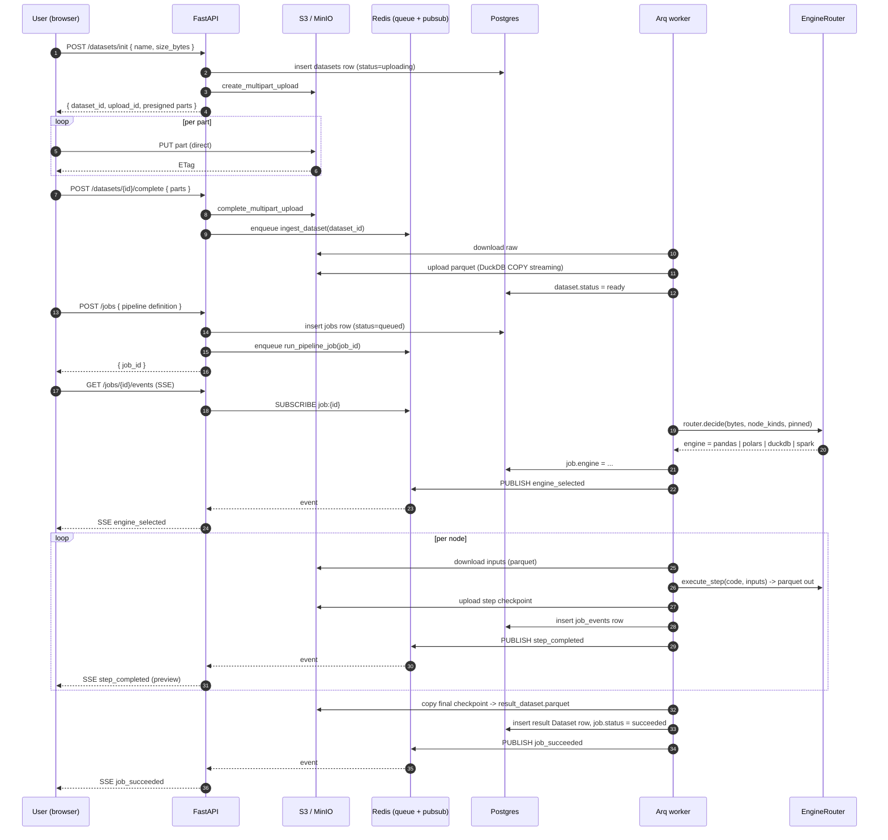
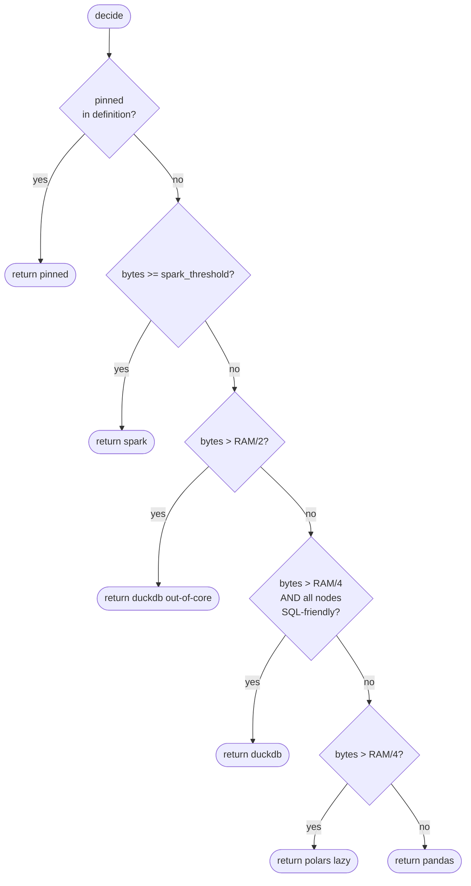

# Architecture

PromptETL-Meg separates **control plane** (API + DB + queue) from **data plane**
(worker pods + engines + object storage). The API never reads or writes user
data; it only mints presigned URLs and enqueues jobs. This is the single most
important property for scaling to large datasets.

## Request lifecycle: upload → run → result



## EngineRouter

The router decides one engine per pipeline run (see
[backend/prompt_etl/engines/router.py](../backend/prompt_etl/engines/router.py)):



RAM is detected at startup from cgroups v2 (`/sys/fs/cgroup/memory.max`), with
fallbacks to cgroups v1, `/proc/meminfo`, and `sysctl hw.memsize` on macOS. An
explicit `ENGINE_RAM_OVERRIDE_BYTES` always wins (useful for tests).

## Engine contract

Every engine implements
[`DataEngine`](../backend/prompt_etl/engines/base.py):

```text
async def execute_step(
    *, node_id, node_kind, code,
    input_object_keys: list[str],   # parquet keys in object storage
    output_object_key: str,         # parquet key to write
    config: dict | None,
) -> StepResult
```

All intermediates are Parquet on object storage. This means a `polars` step
can feed a `duckdb` step in a subsequent run without conversion — and it means
checkpoints survive the worker process.

## Why DuckDB for ingest specifically

A 30 GB CSV would OOM pandas, take minutes in Polars, and require a Spark
cluster. DuckDB's vectorized streaming `COPY (SELECT ...) TO ... (FORMAT
PARQUET)` runs in bounded memory on a single core, spills to disk when needed,
and produces a properly compressed Parquet with row-group statistics — which
the EngineRouter later uses to size Spark executors in Phase 2.

## Resumable SSE

`GET /jobs/{id}/events` accepts both `?after=<seq>` and the standard
`Last-Event-ID` HTTP header. On (re)connect, the API:

1. Reads persisted `job_events` rows with `seq > after` from Postgres (backfill).
2. Subscribes to the Redis pubsub channel `job:{id}` for live events.
3. Yields each event with `id: <seq>` so the browser's `EventSource` can resume
   correctly on the next reconnect.

This is what makes the UI's "Live progress" panel survive a browser refresh
during a 30-minute run.
